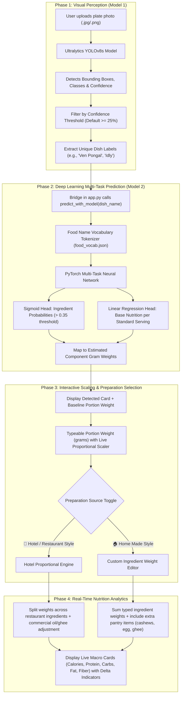
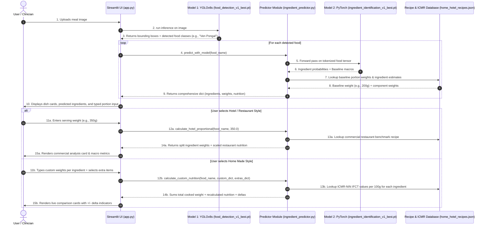

# 🔄 System Workflows, Model Integration & Calculation Engine

This document provides a comprehensive technical reference for the **end-to-end execution workflows**, **inter-module call pipelines**, and **mathematical calculation formulations** powering the South Indian Food Inspection & Nutrition AI System.

---

## 📑 Table of Contents
1. [End-to-End System Workflow](#1-end-to-end-system-workflow)
2. [Sequence of Execution & Inter-Module Communication](#2-sequence-of-execution--inter-module-communication)
3. [The Calculation Engine (Intuitive, Step-by-Step Breakdown)](#3-the-calculation-engine)
   - [Overview: The 3 Calculation Modes](#overview-the-3-calculation-modes)
   - [Formula 1: Standard Serving Weight Scaling (Typeable Portion)](#formula-1-standard-serving-weight-scaling)
   - [Formula 2: Hotel / Restaurant Proportional Split Calculation](#formula-2-hotel--restaurant-proportional-split-calculation)
   - [Formula 3: Home Made Custom Cooking & Extra Ingredients](#formula-3-home-made-custom-cooking--extra-ingredients)
   - [Quick Comparison Matrix: How the 3 Modes Differ](#quick-comparison-matrix)
4. [Source Code Function Mapping (app.py ➔ ingredient_predictor.py)](#4-source-code-function-mapping)
5. [Worked Step-by-Step Example: Ven Pongal](#5-worked-step-by-step-example-ven-pongal)

---

## 1. End-to-End System Workflow

The application couples computer vision (Model 1) with multi-task deep learning and empirical nutritional databases (Model 2) in a 4-phase sequential workflow:



---

## 2. Sequence of Execution & Inter-Module Communication

The following sequence diagram illustrates the exact messaging between the UI layer, the computer vision engine, the predictor module, and the nutritional data sources:



---

## 3. The Calculation Engine

### Overview: The 3 Calculation Modes

The system provides 3 intuitive calculation methods depending on how the user interacts with the app:

| Mode | What the User Does | What the System Calculates |
|:---|:---|:---|
| **Mode 1: Standard Rescaling** | Types any overall portion weight in grams (e.g., changing 200g to 300g) | Proportionally multiplies all predicted ingredient weights and macros by a **Scaling Multiplier**. |
| **Mode 2: Hotel / Restaurant Style** | Types a total restaurant serving weight (e.g., 350g) | Splits the 350g into restaurant ingredient proportions (higher oil/ghee) and scales commercial nutrition. |
| **Mode 3: Home Made Style** | Types exact grams for individual ingredients or adds extras (cashews, ghee, egg) | Computes nutrition from scratch for every single ingredient using official **ICMR-NIN 100g reference values**. |

---

### Formula 1: Standard Serving Weight Scaling

#### Plain English Idea:
> *"If you eat 1.5 times the standard serving of food, you are eating 1.5 times the ingredients and taking in 1.5 times the calories."*

#### Step 1: Find the Scaling Multiplier
$$\text{Scaling Multiplier } (S) = \frac{\text{Portion Weight You Typed (grams)}}{\text{Standard Baseline Weight (grams)}}$$

#### Step 2: Scale Every Ingredient Weight
$$\text{New Ingredient Weight} = \text{Standard Ingredient Weight} \times S$$

#### Step 3: Scale Every Nutritional Value
$$\text{New Calories} = \text{Standard Calories} \times S$$
$$\text{New Protein} = \text{Standard Protein} \times S$$
$$\text{New Carbs} = \text{Standard Carbs} \times S$$
$$\text{New Fat} = \text{Standard Fat} \times S$$
$$\text{New Fiber} = \text{Standard Fiber} \times S$$

#### 🔢 Worked Numbers Example:
* **Dish**: Ven Pongal (Standard Baseline = `200g`, Calories = `335 kcal`, Raw Rice = `70g`).
* **User Types**: `300g`.

1. **Calculate Multiplier**:
   $$S = \frac{300\text{ g}}{200\text{ g}} = 1.5\times$$
2. **Calculate New Ingredient Weight**:
   $$\text{Raw Rice} = 70\text{ g} \times 1.5 = 105.0\text{ g}$$
3. **Calculate New Calories**:
   $$\text{Calories} = 335\text{ kcal} \times 1.5 = 502.5\text{ kcal}$$

#### 💻 Python Code in `app.py` ([Lines 462 & 476](file:///d:/Yolo_Food_Inspection/app.py#L462)):
```python
scale_factor = typed_std_wt / base_std_wt
scaled_ingredient_weight = ingredient_weight * scale_factor
scaled_calories = round(baseline_nutrition['calories_kcal'] * scale_factor, 1)
```

---

### Formula 2: Hotel / Restaurant Proportional Split Calculation

#### Plain English Idea:
> *"A restaurant serves a 350g plate of Ven Pongal. How many grams of rice, moong dal, and ghee are in it? The system takes the restaurant's known recipe ratio, splits the 350g across the ingredients, and computes commercial restaurant nutrition (which has more oil and ghee than home food)."*

#### Step 1: Find the Ingredient Percentage in the Hotel Recipe
$$\text{Ingredient Share (\%)} = \frac{\text{Standard Ingredient Weight in Hotel Recipe (g)}}{\text{Standard Total Hotel Weight (g)}} \times 100\%$$

#### Step 2: Split the User's Typed Weight Across Ingredients
$$\text{Grams in Your Serving} = \text{Total Serving Weight You Typed (g)} \times \left(\frac{\text{Ingredient Share (\%)}}{100}\right)$$

#### Step 3: Scale Restaurant Nutrition
$$\text{Hotel Multiplier } (S_{\text{hotel}}) = \frac{\text{Total Serving Weight You Typed (g)}}{\text{Standard Total Hotel Weight (g)}}$$

$$\text{Hotel Calories} = \text{Standard Hotel Calories} \times S_{\text{hotel}}$$
$$\text{Hotel Fat} = \text{Standard Hotel Fat} \times S_{\text{hotel}}$$

#### 🔢 Worked Numbers Example:
* **Standard Hotel Pongal Serving**: Total = `220g` (contains `75g` Raw Rice, `28g` Ghee/Dalda blend, `410 kcal`, `18g` Fat).
* **User Types**: `330g` Hotel Serving.

1. **Calculate Multiplier**:
   $$S_{\text{hotel}} = \frac{330\text{ g}}{220\text{ g}} = 1.5\times$$
2. **Split Ingredients**:
   $$\text{Raw Rice} = 75\text{ g} \times 1.5 = 112.5\text{ g}$$
   $$\text{Commercial Ghee \& Dalda} = 28\text{ g} \times 1.5 = 42.0\text{ g}$$
3. **Scaled Hotel Nutrition**:
   $$\text{Calories} = 410\text{ kcal} \times 1.5 = 615.0\text{ kcal}$$
   $$\text{Fat} = 18.0\text{ g} \times 1.5 = 27.0\text{ g}$$

#### 💻 Python Code in `ingredient_predictor.py` (`calculate_hotel_proportional`):
```python
scale = round(target_weight_g / base_total, 3)
split_ingredients = {
    ing_name: round(std_weight * scale, 1)
    for ing_name, std_weight in hotel_recipe["ingredients"].items()
}
scaled_hotel_nutrition = {
    nutrient: round(std_value * scale, 1)
    for nutrient, std_value in hotel_recipe["nutrition"].items()
}
```

---

### Formula 3: Home Made Custom Cooking & Extra Ingredients

#### Plain English Idea:
> *"When cooking at home, you control exactly how much rice, dal, or ghee goes into the pot. If you want to add 15g extra cashews or a boiled egg, the system calculates the nutrition for every single ingredient from scratch using the official Indian Food Composition Tables (ICMR-NIN IFCT 2017)."*

#### Step 1: Calculate Total Plate Cooked Weight
Add up the weights of all modified ingredients plus any extra items added:
$$\text{Total Plate Weight (g)} = (\text{Weight of Ingredient 1} + \text{Weight of Ingredient 2} + \dots) + \text{Extra Ingredients Weight}$$

#### Step 2: Calculate Nutrition for Each Ingredient Using ICMR-NIN 100g Values
The ICMR-NIN database stores nutrition **per 100 grams**. For any ingredient:
$$\text{Nutrient from this Ingredient} = \frac{\text{Grams You Used}}{100} \times \text{Nutrient Value in 100g (from ICMR database)}$$

#### Step 3: Sum All Ingredients to Get the Total Plate Nutrition
$$\text{Total Calories} = \text{Calories from Ingredient 1} + \text{Calories from Ingredient 2} + \dots + \text{Calories from Extras}$$
$$\text{Total Protein} = \text{Protein from Ingredient 1} + \text{Protein from Ingredient 2} + \dots + \text{Protein from Extras}$$
$$\text{Total Fat} = \text{Fat from Ingredient 1} + \text{Fat from Ingredient 2} + \dots + \text{Fat from Extras}$$

#### Step 4: Compare with Normal Home Baseline (Delta Difference)
$$\text{Delta } (\Delta) = \text{Your Custom Total} - \text{Normal Standard Baseline}$$
* If $\Delta \text{Calories} > 0$: Displays in UI as `+XX kcal` (warning that meal is richer).
* If $\Delta \text{Protein} > 0$: Displays in UI as `+XX g` (positive indicator for higher protein).

#### 🔢 Worked Numbers Example:
* **User customizes Home Pongal**:
  - `Raw Rice`: Typed as `60g` (ICMR per 100g: 345 kcal, 6.8g protein, 0.5g fat)
  - `Moong Dal`: Typed as `40g` (ICMR per 100g: 348 kcal, 24.5g protein, 1.2g fat)
  - `Pure Cow Ghee`: Typed as `10g` (ICMR per 100g: 900 kcal, 0.0g protein, 100.0g fat)
  - `Extra Fried Cashews`: Added `15g` (ICMR per 100g: 553 kcal, 18.2g protein, 43.8g fat)

1. **Calculate Calories from each**:
   - Rice: $\frac{60}{100} \times 345 = 207.0\text{ kcal}$
   - Moong Dal: $\frac{40}{100} \times 348 = 139.2\text{ kcal}$
   - Ghee: $\frac{10}{100} \times 900 = 90.0\text{ kcal}$
   - Extra Cashews: $\frac{15}{100} \times 553 = 82.95\text{ kcal}$
2. **Sum Total Calories**:
   $$\text{Total Calories} = 207.0 + 139.2 + 90.0 + 82.95 = 519.2\text{ kcal}$$
3. **Calculate Total Protein**:
   $$\text{Total Protein} = \left(\frac{60}{100} \times 6.8\right) + \left(\frac{40}{100} \times 24.5\right) + 0 + \left(\frac{15}{100} \times 18.2\right) = 4.08 + 9.80 + 2.73 = 16.6\text{ g}$$

#### 💻 Python Code in `ingredient_predictor.py` (`calculate_custom_nutrition`):
```python
total_weight = sum(custom_ingredients.values()) + sum(additional_ingredients.values())

for ing_name, weight_g in all_items.items():
    nut_per_100g = get_ingredient_nutrition(ing_name)
    factor = weight_g / 100.0
    total_calories += nut_per_100g['calories_kcal'] * factor
    total_protein  += nut_per_100g['protein_g'] * factor
    total_carbs    += nut_per_100g['carbs_g'] * factor
    total_fat      += nut_per_100g['fat_g'] * factor
    total_fiber    += nut_per_100g['fiber_g'] * factor
```

---

### Quick Comparison Matrix

| Feature | Mode 1: Standard Scaling | Mode 2: Hotel / Restaurant | Mode 3: Home Made Custom |
|:---|:---|:---|:---|
| **Primary Input** | Single Portion Weight (e.g. `250g`) | Overall Hotel Weight (e.g. `350g`) | Individual ingredient weights (g) |
| **How Ingredients are Calculated** | Multiplied by $\frac{\text{typed}}{\text{standard}}$ | Split using commercial recipe ratio | Directly typed by user in number boxes |
| **Pantry Additions Supported?** | No (scales existing set) | No (standard restaurant recipe) | **Yes** (add Cashews, Egg, Ghee, Paneer) |
| **Cooking Fat / Oil Model** | Standard benchmark | High commercial oil/ghee blend | Pure measured home ingredients |
| **Source of Truth** | PyTorch Model 2 baseline | Verified restaurant benchmarks | Official ICMR-NIN IFCT 2017 per 100g |
| **Delta ($\pm$) Indicator** | Difference from standard baseline | Difference from standard hotel | Live difference from home recipe |

---

## 4. Source Code Function Mapping

The table below maps the UI interactions in [app.py](file:///d:/Yolo_Food_Inspection/app.py) to their respective backend implementations in [Incredient_Identification/ingredient_predictor.py](file:///d:/Yolo_Food_Inspection/Incredient_Identification/ingredient_predictor.py):

| Workflow Phase | UI Interaction in `app.py` | Function Called in `ingredient_predictor.py` | Function Purpose |
|:---|:---|:---|:---|
| **Perception** | Image Upload ➔ `food_detection_v1_best.pt` | Ultralytics `YOLO.predict(img)` | Identifies bounding boxes & dish names (Model 1) |
| **Prediction** | Loop over unique detected foods ([Line 443](file:///d:/Yolo_Food_Inspection/app.py#L443)) | `predict_with_model(food_name)` | Runs PyTorch Model 2 multi-task inference for ingredients + base nutrition |
| **Recipe Fetch** | Expand dish details ([Line 184](file:///d:/Yolo_Food_Inspection/app.py#L184)) | `get_home_hotel_recipe(food_name)` | Retrieves baseline Home & Hotel recipes from `home_hotel_recipes.json` |
| **Hotel Mode** | User types hotel weight ([Line 213](file:///d:/Yolo_Food_Inspection/app.py#L213)) | `calculate_hotel_proportional(food_name, typed_hotel_weight)` | Proportionally splits ingredient grams and scales commercial macros |
| **Home Mode** | User types ingredient grams / adds extras ([Line 283](file:///d:/Yolo_Food_Inspection/app.py#L283)) | `calculate_custom_nutrition(food_name, custom_dict, extras_dict)` | Component-level sum of typed weights using ICMR-NIN IFCT 100g reference tables |
| **Direct Test** | Text test in Tab 2 ([Line 552](file:///d:/Yolo_Food_Inspection/app.py#L552)) | `get_predictor().predict(food_name)` | Direct Model 2 inference testing without image upload |

---

## 5. Worked Step-by-Step Example: Ven Pongal

### Step 1: Model 1 Detection
- **Input**: Photo of breakfast plate.
- **Model 1 Output**: Class `Ven Pongal`, Confidence `94.2%`.

### Step 2: Model 2 Inference (`predict_with_model("Ven Pongal")`)
- **PyTorch Model Outputs**:
  - `Raw Rice`: Confidence 99.8%, Estimated Weight = 70.0g
  - `Moong Dal`: Confidence 98.6%, Estimated Weight = 35.0g
  - `Ghee`: Confidence 95.4%, Estimated Weight = 15.0g
  - `Black Pepper`: Confidence 92.1%, Estimated Weight = 3.0g
  - `Cumin Seeds`: Confidence 91.5%, Estimated Weight = 3.0g
  - `Ginger`: Confidence 88.0%, Estimated Weight = 5.0g
  - `Cashew Nuts`: Confidence 86.4%, Estimated Weight = 8.0g
  - `Curry Leaves`: Confidence 84.0%, Estimated Weight = 2.0g
- **Baseline Weight**: 200g
- **Baseline Nutrition**: Calories: 335.0 kcal, Protein: 8.2g, Carbs: 48.0g, Fat: 12.5g, Fiber: 3.2g.

---

### Step 3A: If User Chooses Hotel Style (Serving Weight: 300g)
1. **Benchmark Restaurant Serving**: 220g (Calories: 410.0 kcal, Fat: 18.0g).
2. **Scale Factor**:
   $$S = \frac{300}{220} \approx 1.364$$
3. **Split Ingredients**:
   - `Raw Rice`: $75\text{g} \times 1.364 = 102.3\text{g}$
   - `Moong Dal`: $35\text{g} \times 1.364 = 47.7\text{g}$
   - `Commercial Ghee & Dalda Blend`: $28\text{g} \times 1.364 = 38.2\text{g}$
   - `Cashew Nuts`: $10\text{g} \times 1.364 = 13.6\text{g}$
   - `Black Pepper & Cumin`: $6\text{g} \times 1.364 = 8.2\text{g}$
4. **Scaled Nutrition Displayed in UI**:
   - **Calories**: $410.0 \times 1.364 = 559.1\text{ kcal}$
   - **Protein**: $8.5 \times 1.364 = 11.6\text{ g}$
   - **Carbs**: $46.0 \times 1.364 = 62.7\text{ g}$
   - **Fat**: $18.0 \times 1.364 = 24.5\text{ g}$
   - **Fiber**: $2.8 \times 1.364 = 3.8\text{ g}$

---

### Step 3B: If User Chooses Home Made Style (Custom Typed Weights)
1. **User Types Custom Ingredient Weights**:
   - `Raw Rice`: Typed as `60g` (Nutrient density: 345 kcal, 6.8g prot, 78.2g carb, 0.5g fat per 100g)
   - `Moong Dal`: Typed as `40g` (Nutrient density: 348 kcal, 24.5g prot, 59.9g carb, 1.2g fat per 100g)
   - `Pure Cow Ghee`: Typed as `10g` (Nutrient density: 900 kcal, 0.0g prot, 0.0g carb, 100.0g fat per 100g)
2. **User Adds Extra Pantry Items**:
   - `Cashew Nuts`: Selected from dropdown, typed as `15g` (Nutrient density: 553 kcal, 18.2g prot, 30.2g carb, 43.8g fat per 100g)
3. **Engine Summation**:
   - **Total Cooked Weight**: $60 + 40 + 10 + 15 = 125\text{g}$ (Dry ingredient weight basis)
   - **Calories**:
     $$\left(\frac{60}{100} \times 345\right) + \left(\frac{40}{100} \times 348\right) + \left(\frac{10}{100} \times 900\right) + \left(\frac{15}{100} \times 553\right) = 207.0 + 139.2 + 90.0 + 82.95 = 519.2\text{ kcal}$$
   - **Protein**:
     $$\left(\frac{60}{100} \times 6.8\right) + \left(\frac{40}{100} \times 24.5\right) + 0 + \left(\frac{15}{100} \times 18.2\right) = 4.08 + 9.80 + 2.73 = 16.6\text{ g}$$
4. **UI Delta Display**:
   - Shows live metric cards with exact `+` or `-` differences compared to the standard 200g home baseline.
