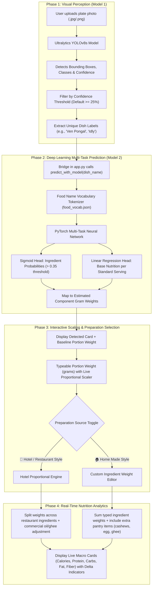
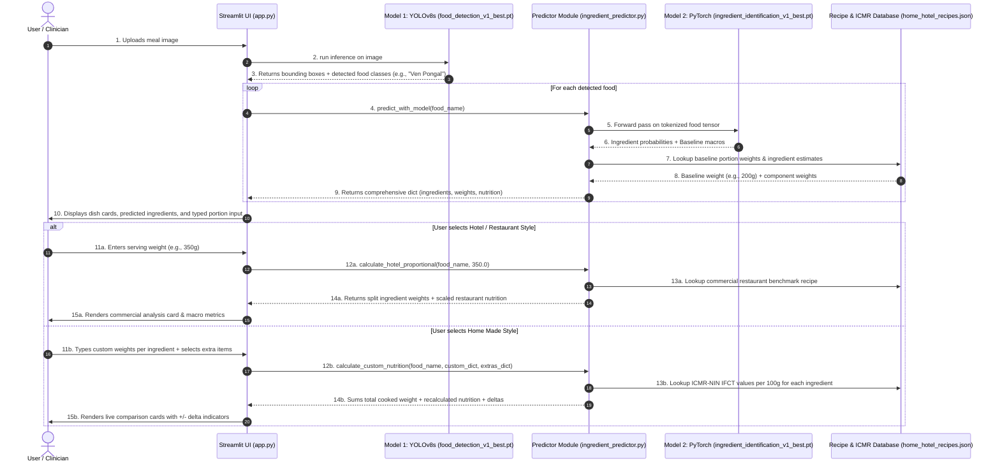

# 🔄 System Workflows, Model Integration & Calculation Engine

This document provides a comprehensive technical reference for the **end-to-end execution workflows**, **inter-module call pipelines**, and **mathematical calculation formulations** powering the South Indian Food Inspection & Nutrition AI System.

---

## 📑 Table of Contents
1. [End-to-End System Workflow](#1-end-to-end-system-workflow)
2. [Sequence of Execution & Inter-Module Communication](#2-sequence-of-execution--inter-module-communication)
3. [The Calculation Engine](#3-the-calculation-engine)
   - [A. Baseline Portion Weight & Proportional Scaling](#a-baseline-portion-weight--proportional-scaling)
   - [B. Hotel / Restaurant Mode Proportional Split Calculation](#b-hotel--restaurant-mode-proportional-split-calculation)
   - [C. Home Made Mode Custom Typed Weights & Additional Ingredients](#c-home-made-mode-custom-typed-weights--additional-ingredients)
4. [Source Code Function Mapping (app.py ➔ ingredient_predictor.py)](#4-source-code-function-mapping)
5. [Worked Step-by-Step Example: Ven Pongal](#5-worked-step-by-step-example-ven-pongal)

---

## 1. End-to-End System Workflow

The application couples computer vision (Model 1) with multi-task deep learning and empirical nutritional databases (Model 2) in a 4-phase sequential workflow:

---

## 2. Sequence of Execution & Inter-Module Communication

The following sequence diagram illustrates the exact messaging between the UI layer, the computer vision engine, the predictor module, and the nutritional data sources:

---

## 3. The Calculation Engine

### A. Baseline Portion Weight & Proportional Scaling

When Model 2 predicts the nutrition and ingredients for a dish, the values correspond to an empirical **standard baseline portion weight** $W_{\text{base}}$ (e.g., 200g for Ven Pongal, 120g for Dosa).

When the user modifies the portion weight in the UI to a typed weight $W_{\text{typed}}$, the system computes a dimensionless scale factor $S$:

$$S = \frac{W_{\text{typed}}}{W_{\text{base}}}$$

Each individual predicted ingredient weight $w_i$ and each baseline nutritional parameter $N_{\text{base}} \in \{\text{Calories}, \text{Protein}, \text{Carbs}, \text{Fat}, \text{Fiber}\}$ scales proportionally:

$$w_i' = w_i \times S$$

$$N' = N_{\text{base}} \times S$$

$$\Delta N = N' - N_{\text{base}}$$

---

### B. Hotel / Restaurant Mode Proportional Split Calculation

In commercial establishments (hotels, restaurants, tiffin centers), recipes use standardized bulk preparation formulas with elevated cooking fats (oil, ghee, dalda) and sodium.

#### 1. Proportional Ingredient Weight Allocation:
Given a benchmark restaurant portion with standard total weight $W_{\text{hotel, std}}$ containing $k$ constituent ingredients with benchmark weights $w_{1, \text{std}}, w_{2, \text{std}}, \dots, w_{k, \text{std}}$:

The weight proportion $p_i$ of each ingredient $i$ is:

$$p_i = \frac{w_{i, \text{std}}}{W_{\text{hotel, std}}}$$

When the user enters a typed hotel serving weight $W_{\text{hotel, typed}}$, the weight allocated to ingredient $i$ is:

$$w_{i, \text{typed}} = W_{\text{hotel, typed}} \times p_i$$

#### 2. Nutritional Composition Scaling:
The nutritional values scale linearly from the commercial recipe benchmark:

$$S_{\text{hotel}} = \frac{W_{\text{hotel, typed}}}{W_{\text{hotel, std}}}$$

$$\text{Calories}_{\text{hotel}} = \text{Calories}_{\text{std}} \times S_{\text{hotel}}$$

$$\text{Nutrient}_{j, \text{hotel}} = \text{Nutrient}_{j, \text{std}} \times S_{\text{hotel}}$$

---

### C. Home Made Mode Custom Typed Weights & Additional Ingredients

In home cooking, ingredient proportions vary significantly based on dietary preferences. The home calculation engine operates at the **raw/cooked component level**, sourcing verified nutritional density per 100g from the **ICMR-NIN Indian Food Composition Tables (IFCT 2017)**.

#### 1. Total Cooked Portion Weight:
Let $\mathcal{I}_{\text{custom}}$ be the set of modified base recipe ingredients, and $\mathcal{I}_{\text{extra}}$ be the set of newly added pantry ingredients (e.g., Cashew nuts, Extra Ghee, Boiled Egg, Paneer):

$$W_{\text{total, home}} = \sum_{j \in \mathcal{I}_{\text{custom}}} w_j + \sum_{k \in \mathcal{I}_{\text{extra}}} w_k$$

#### 2. Macronutrient Summation Formulas:
For any nutritional attribute $N \in \{\text{Calories (kcal)}, \text{Protein (g)}, \text{Carbs (g)}, \text{Fat (g)}, \text{Fiber (g)}\}$:

$$N_{\text{total}} = \sum_{m \in (\mathcal{I}_{\text{custom}} \cup \mathcal{I}_{\text{extra}})} \left( \frac{w_m}{100} \times \nu_N(m) \right)$$

Where:
- $w_m$ is the weight in grams of ingredient $m$.
- $\nu_N(m)$ is the nutritional density of nutrient $N$ per 100g of ingredient $m$ as published by ICMR-NIN.

#### 3. Delta Variance Analysis:
The UI computes the differential against the standard home baseline:

$$\Delta N = N_{\text{total}} - N_{\text{home, benchmark}}$$

- If $\Delta \text{Calories} > 0$: Displayed as `+XX kcal` (Orange/Warning).
- If $\Delta \text{Protein} > 0$: Displayed as `+XX g` (Green/Positive).

---

## 4. Source Code Function Mapping

The table below maps the UI interactions in [app.py](file:///d:/Yolo_Food_Inspection/app.py) to their respective backend implementations in [Incredient_Identification/ingredient_predictor.py](file:///d:/Yolo_Food_Inspection/Incredient_Identification/ingredient_predictor.py):

| Workflow Phase | UI Interaction in `app.py` | Function Called in `ingredient_predictor.py` | Function Purpose |
|:---|:---|:---|:---|
| **Perception** | Image Upload ➔ `food_detection_v1_best.pt` | Ultralytics `YOLO.predict(img)` | Identifies bounding boxes & dish names (Model 1) |
| **Prediction** | Loop over unique detected foods ([Line 443](file:///d:/Yolo_Food_Inspection/app.py#L443)) | `predict_with_model(food_name)` | Runs PyTorch Model 2 multi-task inference for ingredients + base nutrition |
| **Recipe Fetch** | Expand dish details ([Line 184](file:///d:/Yolo_Food_Inspection/app.py#L184)) | `get_home_hotel_recipe(food_name)` | Retrieves baseline Home & Hotel recipes from `home_hotel_recipes.json` |
| **Hotel Mode** | User types hotel weight ([Line 213](file:///d:/Yolo_Food_Inspection/app.py#L213)) | `calculate_hotel_proportional(food_name, typed_hotel_weight)` | Proportionally splits ingredient grams and scales commercial macros |
| **Home Mode** | User types ingredient grams / adds extras ([Line 283](file:///d:/Yolo_Food_Inspection/app.py#L283)) | `calculate_custom_nutrition(food_name, custom_dict, extras_dict)` | Component-level sum of typed weights using ICMR-NIN IFCT 100g reference tables |
| **Direct Test** | Text test in Tab 2 ([Line 552](file:///d:/Yolo_Food_Inspection/app.py#L552)) | `get_predictor().predict(food_name)` | Direct Model 2 inference testing without image upload |

---

## 5. Worked Step-by-Step Example: Ven Pongal

### Step 1: Model 1 Detection
- **Input**: Photo of breakfast plate.
- **Model 1 Output**: Class `Ven Pongal`, Confidence `94.2%`.

### Step 2: Model 2 Inference (`predict_with_model("Ven Pongal")`)
- **PyTorch Model Outputs**:
  - `Raw Rice`: Confidence 99.8%, Estimated Weight = 70.0g
  - `Moong Dal`: Confidence 98.6%, Estimated Weight = 35.0g
  - `Ghee`: Confidence 95.4%, Estimated Weight = 15.0g
  - `Black Pepper`: Confidence 92.1%, Estimated Weight = 3.0g
  - `Cumin Seeds`: Confidence 91.5%, Estimated Weight = 3.0g
  - `Ginger`: Confidence 88.0%, Estimated Weight = 5.0g
  - `Cashew Nuts`: Confidence 86.4%, Estimated Weight = 8.0g
  - `Curry Leaves`: Confidence 84.0%, Estimated Weight = 2.0g
- **Baseline Weight**: 200g
- **Baseline Nutrition**: Calories: 335.0 kcal, Protein: 8.2g, Carbs: 48.0g, Fat: 12.5g, Fiber: 3.2g.

---

### Step 3A: If User Chooses Hotel Style (Serving Weight: 300g)
1. **Benchmark Restaurant Serving**: 220g (Calories: 410.0 kcal, Fat: 18.0g).
2. **Scale Factor**:
   $$S = \frac{300}{220} \approx 1.364$$
3. **Split Ingredients**:
   - `Raw Rice`: $75\text{g} \times 1.364 = 102.3\text{g}$
   - `Moong Dal`: $35\text{g} \times 1.364 = 47.7\text{g}$
   - `Commercial Ghee & Dalda Blend`: $28\text{g} \times 1.364 = 38.2\text{g}$
   - `Cashew Nuts`: $10\text{g} \times 1.364 = 13.6\text{g}$
   - `Black Pepper & Cumin`: $6\text{g} \times 1.364 = 8.2\text{g}$
4. **Scaled Nutrition Displayed in UI**:
   - **Calories**: $410.0 \times 1.364 = 559.1\text{ kcal}$
   - **Protein**: $8.5 \times 1.364 = 11.6\text{ g}$
   - **Carbs**: $46.0 \times 1.364 = 62.7\text{ g}$
   - **Fat**: $18.0 \times 1.364 = 24.5\text{ g}$
   - **Fiber**: $2.8 \times 1.364 = 3.8\text{ g}$

---

### Step 3B: If User Chooses Home Made Style (Custom Typed Weights)
1. **User Types Custom Ingredient Weights**:
   - `Raw Rice`: Typed as `60g` (Nutrient density: 345 kcal, 6.8g prot, 78.2g carb, 0.5g fat per 100g)
   - `Moong Dal`: Typed as `40g` (Nutrient density: 348 kcal, 24.5g prot, 59.9g carb, 1.2g fat per 100g)
   - `Pure Cow Ghee`: Typed as `10g` (Nutrient density: 900 kcal, 0.0g prot, 0.0g carb, 100.0g fat per 100g)
2. **User Adds Extra Pantry Items**:
   - `Cashew Nuts`: Selected from dropdown, typed as `15g` (Nutrient density: 553 kcal, 18.2g prot, 30.2g carb, 43.8g fat per 100g)
3. **Engine Summation**:
   - **Total Cooked Weight**: $60 + 40 + 10 + 15 = 125\text{g}$ (Dry ingredient weight basis)
   - **Calories**:
     $$\left(\frac{60}{100} \times 345\right) + \left(\frac{40}{100} \times 348\right) + \left(\frac{10}{100} \times 900\right) + \left(\frac{15}{100} \times 553\right) = 207.0 + 139.2 + 90.0 + 82.95 = 519.2\text{ kcal}$$
   - **Protein**:
     $$\left(\frac{60}{100} \times 6.8\right) + \left(\frac{40}{100} \times 24.5\right) + 0 + \left(\frac{15}{100} \times 18.2\right) = 4.08 + 9.80 + 2.73 = 16.6\text{ g}$$
4. **UI Delta Display**:
   - Shows live metric cards with exact `+` or `-` differences compared to the standard 200g home baseline.

